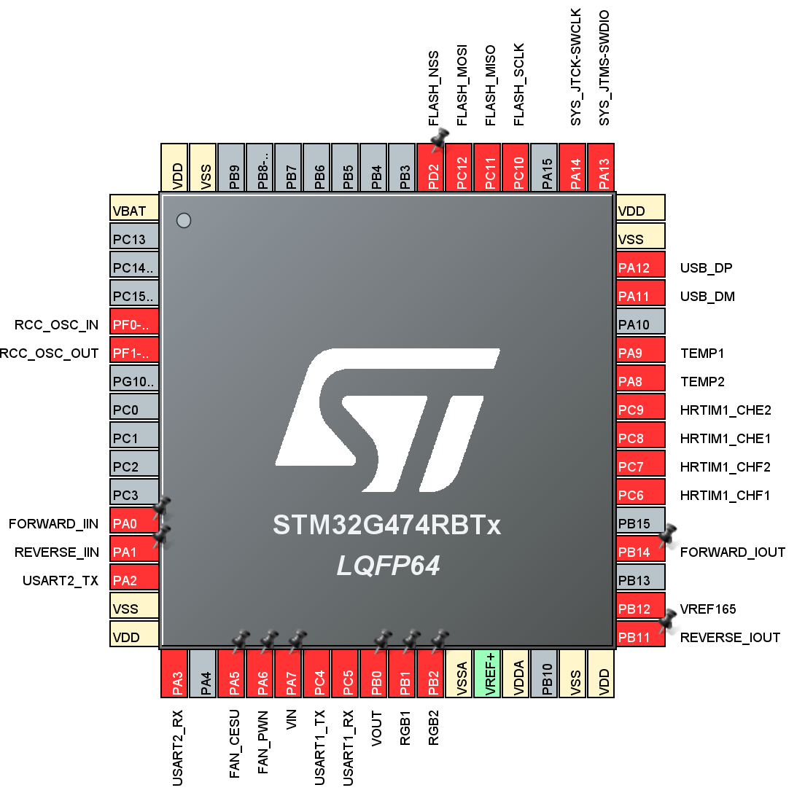
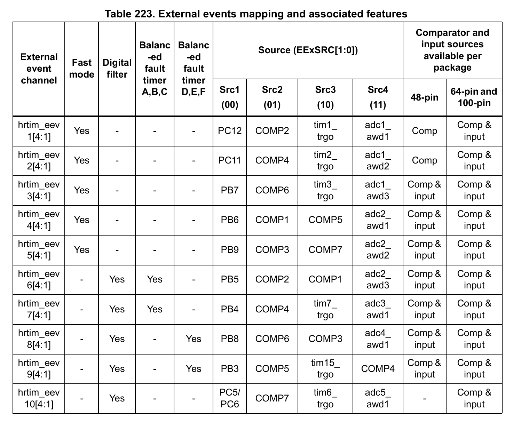

## COMP和 EEV配置

基于 [RM0440](datesheet/RM0440.pdf)的28.3.2章的Table 223

物理接口 PA0和 PA1的物理引脚全部连接到INA240A1的输出端，其实采样的都是一个电流信号
  PB11 和 PB14 同理

首先，正向电流和反向电流OTP事件全部由COMP事件触发，由于有两个电流方向，所以FORWARD和REVERSE封为不同的COMP极性和EEV触发极性

| F/R          | COMPX | OUT Polarity                       |
|--------------|-------|------------------------------------|
| FORWARD_IIN  | COMP3 | COMP output is inverted |
| FORWARD_IOUT | COMP7 | COMP output is inverted |
| REVERSE_IIN  | COMP1 | COMP output on GPIO is inverted    |   
| REVERSE_IOUT | COMP6 | COMP output on GPIO is inverted    |    

COMP和EEVX对应图表

| COMPX | COMP Polarity | COMP Event       | EEVX  | Event Polarity                | Event Sensitivity                 |
|-------|---------------|------------------|-------|-------------------------------|-----------------------------------|
| COMP1 | inverted      | REVERSE_IIN OCP  | EEV4  | External event is active low  | External event is active on level |
| COMP6 | inverted      | REVERSE_IOUT OCP | EEV3  | External event is active low  | External event is active on level |
| COMP3 | inverted      | FORWARD_IIN OCP  | EEV5  | External event is active high | External event is active on level |
| COMP7 | inverted      | FORWARD_IOUT OCP | EEV10 | External event is active high | External event is active on level |
| COMP2 | NOT inverted  | VIN OVP          | EEV1  | External event is active high | External event is active on level |
| COMP4 | NOT inverted  | VOUT OVP         | EEV2  | External event is active high | External event is active on level |

> 在SRC2来源中，ADCX_AWD不能做为Source，只能配置COMP，所以ADC5的温度只能软件OTP

正向电流时 INA240 输出低于 VREF165，故 COMP3/COMP7 使用 DAC 低阈值：输入低于
阈值时，反相后的 COMP 输出为高电平，触发高有效的 EEV5/EEV10。反向电流使用 DAC
高阈值，COMP1/COMP6 的反相输出为低电平，触发低有效的 EEV4/EEV3。
